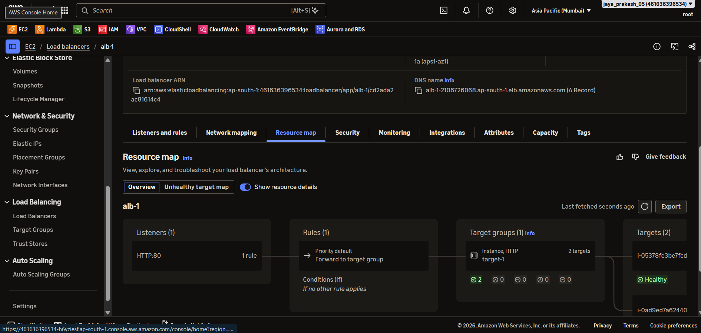
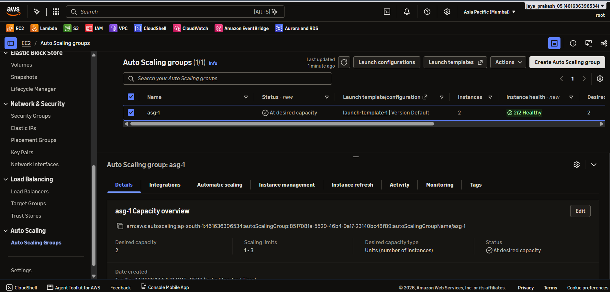
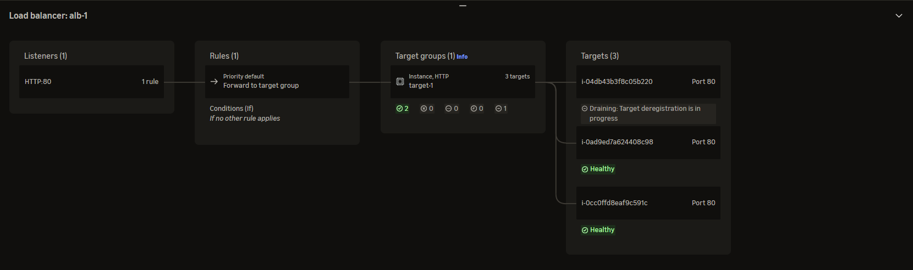
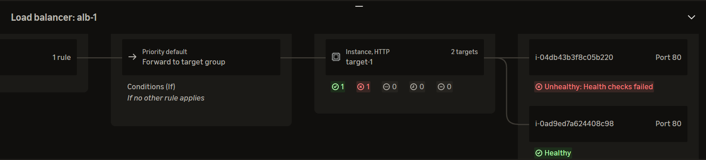
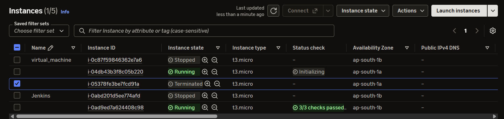
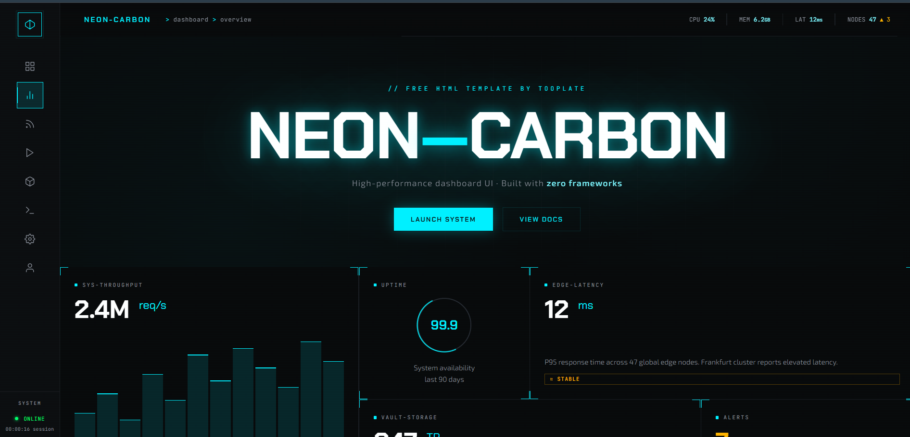

# High-Availability Web Application Architecture with AWS Auto Scaling and Application Load Balancer (ALB)

## 🎯 Project Overview

This project demonstrates the implementation of a fault-tolerant, highly available, and scalable web application infrastructure on Amazon Web Services (AWS).

It uses an Application Load Balancer (ALB) to distribute incoming HTTP traffic across multiple EC2 instances managed by an Auto Scaling Group (ASG) spanning multiple Availability Zones.

---

## 🏗️ Architecture & Workflow

1. **Virtual Private Cloud (VPC):** Configured a custom VPC (`vpc-1`) featuring public subnets across multiple Availability Zones (`ap-south-1a`, `ap-south-1b`) for high availability.
2. **Launch Template & EC2:** Created a standardized Launch Template with User Data scripts, security groups, and IAM roles to launch `t3.micro` instances.
3. **Application Load Balancer (ALB):** Deployed `alb-1` to receive public HTTP traffic on port 80 and distribute requests.
4. **Target Group & Health Checks:** Configured a Target Group (`target-1`) with HTTP health checks to monitor instance health and route traffic away from unhealthy instances.
5. **Auto Scaling Group (ASG):** Configured `asg-1` with a desired capacity of 2 instances, a minimum of 1, and a maximum of 3 to support automatic scaling and instance replacement.

---

## 📷 Architecture & Console Snapshots

### 1. Custom VPC & Subnet Topology

- **VPC:** `vpc-1`
- **Availability Zones:** `ap-south-1a` and `ap-south-1b`
- **Subnets:** `sub-1` and `sub-2`


### 2. Application Load Balancer (ALB)

- **ALB Name:** `alb-1`
- **DNS Name:** `alb-1-2106726068.ap-south-1.elb.amazonaws.com`
- **Purpose:** Distributes incoming HTTP traffic across registered EC2 instances.



### 3. Auto Scaling Group (ASG)

- **ASG Name:** `asg-1`
- **Desired Capacity:** 2
- **Minimum Capacity:** 1
- **Maximum Capacity:** 3



### 4. Target Group Health Checks

The Target Group monitors the health of EC2 instances using HTTP health checks.



### 5. Unhealthy Instance Detection

Demonstrates how an unhealthy instance is identified through health checks.



### 6. Automatic Instance Replacement

Demonstrates the Auto Scaling Group replacing a terminated or unhealthy instance to maintain the desired capacity.



---

## 🌐 Deployed Application: Neon-Carbon Dashboard

- **Application Type:** Lightweight dashboard UI built without frameworks.
- **Deployment Method:** Deployed on multiple AWS EC2 instances using User Data scripts.
- **Traffic Management:** Application Load Balancer distributes incoming requests across the instances.

### Application Preview



---

## 🛠️ Skills & Technologies Used

- **Compute:** Amazon EC2, Launch Templates, Auto Scaling Groups
- **Networking:** Amazon VPC, Application Load Balancer, Target Groups, Public Subnets, Route Tables
- **Security:** AWS IAM, Security Groups
- **Monitoring:** EC2 Status Checks, Target Group Health Checks
- **Automation:** EC2 User Data Scripts, Auto Scaling

---

## 🚀 Deployment Steps

1. **Create VPC:** Configure a custom VPC with public subnets across at least two Availability Zones.
2. **Configure Security Groups:** Allow inbound HTTP traffic on port 80 and SSH traffic on port 22, restricting SSH access to trusted IP addresses.
3. **Create Launch Template:** Select the AMI, instance type (`t3.micro`), key pair, security groups, IAM role, and User Data script.
4. **Create Target Group:** Configure an HTTP target group with suitable health check settings.
5. **Create Application Load Balancer:** Deploy a public-facing ALB and associate it with the target group.
6. **Create Auto Scaling Group:** Configure the ASG using the Launch Template and attach the ALB target group.
7. **Verify Deployment:** Check instance health, access the application using the ALB DNS name, and test automatic instance replacement.

---

## 📁 Repository Structure

```text
aws-autoscaling-alb-deployment/
│
├── README.md
│
└── screenshots/
    ├── asg.png
    ├── load_balancer.png
    ├── neaon.png
    ├── positive_health.png
    ├── terminated.png
    ├── unhealthy.png
    └── vpc.png
```

---

## 🎯 Project Outcome

Successfully deployed a scalable and highly available web application infrastructure using AWS EC2, Application Load Balancer, and Auto Scaling Groups across multiple Availability Zones.

The project demonstrates load balancing, health monitoring, fault tolerance, and automatic EC2 instance replacement.
