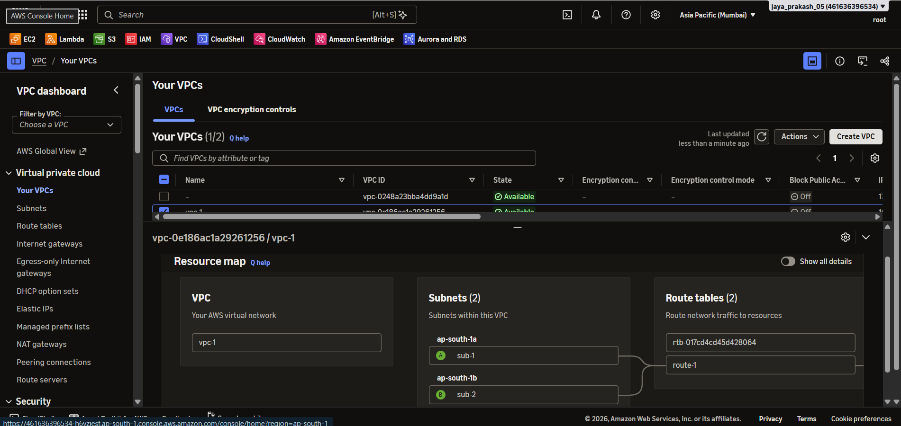

# High-Availability Web Application Architecture with AWS Auto Scaling and Application Load Balancer (ALB)

## 🎯 Project Overview
This project demonstrates the implementation of a fault-tolerant, highly available, and scalable web application infrastructure on Amazon Web Services (AWS). It utilizes an Application Load Balancer (ALB) to distribute incoming HTTP traffic across multiple EC2 instances managed dynamically by an Auto Scaling Group (ASG) spanning multiple Availability Zones.

---

## 🏗️ Architecture & Workflow
1. **Virtual Private Cloud (VPC):** Configured a custom VPC (`vpc-1`) featuring public subnets across multiple Availability Zones (`ap-south-1a`, `ap-south-1b`) for high availability.
2. **Launch Template & EC2:** Created a standardized Launch Template configured with necessary user-data scripts, security groups, and IAM roles to spin up `t3.micro` instances.
3. **Application Load Balancer (ALB):** Deployed `alb-1` facing the public internet on port 80 to route incoming web requests.
4. **Target Group & Health Checks:** Configured a Target Group (`target-1`) with HTTP health checks to actively monitor instance responsiveness and automatically reroute traffic away from unhealthy instances.
5. **Auto Scaling Group (ASG):** Set up `asg-1` with a desired capacity of 2 instances and scaling limits ranging from 1 to 3 instances to ensure elastic scaling and automatic self-healing.

---

## 📷 Architecture & Console Snapshots

### 1. Custom VPC & Subnet Topology
- **VPC:** `vpc-1` spanning `ap-south-1a` (`sub-1`) and `ap-south-1b` (`sub-2`) with structured route tables.
  

### 2. Application Load Balancer (ALB) & Healthy Targets
- **ALB Name:** `alb-1`
- **DNS Name:** `alb-1-2106726068.ap-south-1.elb.amazonaws.com`
- **Targets:** Actively balancing traffic across healthy EC2 instances with passing HTTP health checks.
  

### 3. Auto Scaling Group (ASG) Management
- **ASG Name:** `asg-1`
- **Capacity:** Desired: 2 | Min: 1 | Max: 3
- **Status:** At desired capacity (`2/2 Healthy`).
  

---

## 🛠️ Skills & Technologies Used
* **Compute:** Amazon EC2, Launch Templates, Auto Scaling Groups (ASG)
* **Networking:** Amazon VPC, Application Load Balancer (ALB), Target Groups, Subnets, Route Tables
* **Security & Governance:** AWS IAM, Security Groups
* **Monitoring:** EC2 Status Checks, Target Health Checks

---

## 🚀 Deployment Steps
1. **Create the VPC:** Set up a custom VPC with public subnets across at least two Availability Zones.
2. **Configure Security Groups:** Allow inbound HTTP (`Port 80`) and SSH (`Port 22`) traffic.
3. **Build a Launch Template:** Define the AMI, instance type (`t3.micro`), key pair, and security settings.
4. **Create a Target Group & ALB:** Set up `target-1` specifying HTTP health checks and attach it to `alb-1`.
5. **Set up Auto Scaling Group:** Launch `asg-1` using your template, link it to the ALB target group, and configure scaling policies (Desired: 2, Min: 1, Max: 3).

## 🌐 Deployed Application: Neon-Carbon Dashboard
* **Application Type:** High-performance dashboard UI ("Neon-Carbon") built with zero frameworks.
* **Deployment Method:** Packaged and deployed via user-data scripts onto multiple AWS EC2 instances behind an Application Load Balancer (ALB).
* **Key Metrics Monitored:** High-throughput request handling, edge latency, and system availability.

### Application Preview
![Neon-Carbon Dashboard UI]

